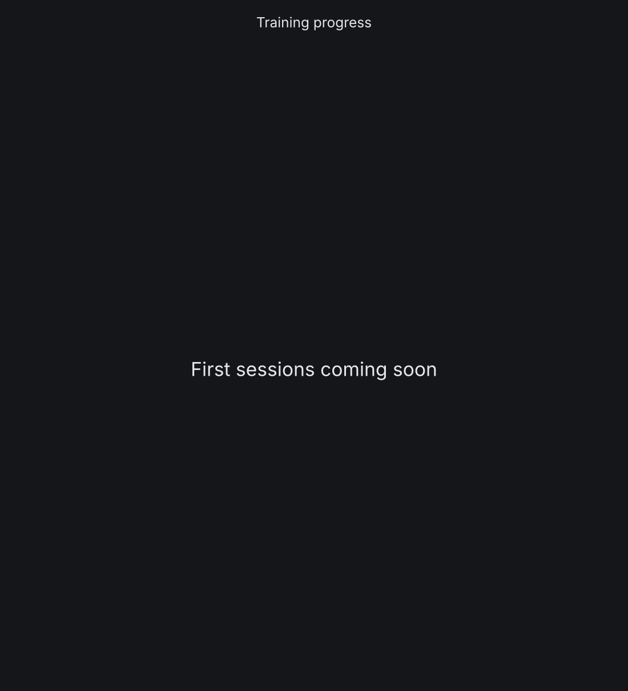

# Training data

My training log, backed up automatically from my phone. The chart below is redrawn every time new data arrives.

The chart shows what was done: top working weights for squat, deadlift and Romanian deadlift, sessions done each week, and treadmill minutes each week. Quiet weeks are just quiet weeks.

## What is in here

- `data/gym/YYYY-MM.csv`: one row per working set (date, exercise, set number, weight, reps, target reps, reps in reserve).
- `data/treadmill/YYYY-MM.csv`: one row per treadmill session (date, style, planned and completed minutes).
- `data/other/YYYY-MM.csv`: core and hike sessions (date, type, minutes).
- `data/summary.json`: top weights and session counts per week.

## What is NOT in here

No daily feeling ratings, no pain or injury details, no notes, no travel or time-available answers, no recommendation history, and no free-text exercise names. Those stay on my phone and are filtered out before anything is uploaded.

## Auto-generated

Everything here is written by the app and a GitHub Action (`.github/workflows/chart.yml`). Please do not edit the data files by hand; the next sync will overwrite them.
